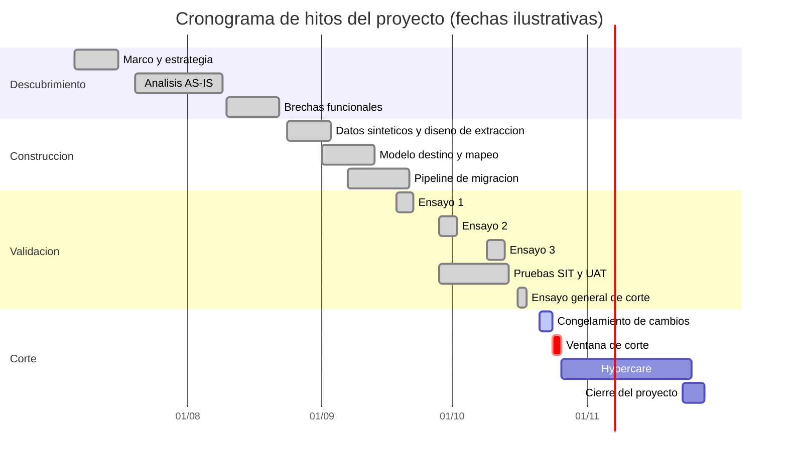

# Estrategia de migración

| Proyecto | Migración del core bancario — Banco Meridiano Austral (entidad ficticia) |
|---|---|
| **Versión** | 1.0 |
| **Fecha** | 19/10/2026 |
| **Autor** | Franco Tilleria, Analista de Negocios |
| **Estado** | Aprobado |

## Control de versiones

| Versión | Fecha | Autor | Cambio |
|---|---|---|---|
| 1.0 | 19/10/2026 | Franco Tilleria | Versión inicial. |

## Propósito

Comparar las estrategias de migración posibles (big bang, por olas, paralelo) con
criterios ponderados, documentar la decisión y presentar el cronograma por hitos.

## Criterios y ponderaciones

| Criterio | Peso | Fundamento |
|---|---|---|
| Riesgo operacional | 20 % | Una falla afecta directamente a los clientes. |
| Costo total | 15 % | Restricción presupuestaria del directorio. |
| Tiempo hasta el valor | 10 % | Eliminar el costo del legado cuanto antes. |
| Complejidad de conciliación | 15 % | La conciliación es la barrera de aceptación. |
| Interdependencia entre productos | 15 % | Cuentas, préstamos y mandatos se referencian entre sí. |
| Impacto en el cliente | 15 % | Continuidad del servicio y confianza. |
| Capacidad del equipo | 10 % | Equipo funcional y técnico acotado. |

Escala de puntaje: 1 = muy desfavorable, 5 = muy favorable.

<!-- INICIO AUTO: matriz-estrategia -->
| Criterio (peso) | Big bang (corte unico de fin de semana) | Por olas (migracion gradual por producto o segmento) | Paralelo (operacion simultanea de ambos cores) |
|---|---|---|---|
| Riesgo operacional (20 %) | 2.0 | 4.0 | 5.0 |
| Costo total (15 %) | 4.0 | 2.5 | 1.0 |
| Tiempo hasta el valor (10 %) | 5.0 | 2.5 | 2.0 |
| Complejidad de conciliacion (15 %) | 2.5 | 4.0 | 4.5 |
| Interdependencia entre productos (15 %) | 5.0 | 2.0 | 2.0 |
| Impacto en el cliente (15 %) | 3.0 | 4.0 | 4.5 |
| Capacidad del equipo (10 %) | 4.5 | 3.0 | 2.0 |
| **Puntaje ponderado** | **3.525** | **3.225** | **3.200** |

**Resultado calculado:** la opcion recomendada es **Big bang (corte unico de fin de semana)** con 3.525 puntos ponderados, seguida de Por olas (migracion gradual por producto o segmento) con 3.225.

- **Big bang (corte unico de fin de semana)** (3.525): Un unico corte elimina las conciliaciones cruzadas entre legado y nuevo core. El riesgo se compensa con tres ensayos, paralelo de saldos y plan de reversa.

- **Por olas (migracion gradual por producto o segmento)** (3.225): Menor riesgo por ola, pero obliga a doble operacion y conciliaciones cruzadas entre productos que se referencian entre si durante meses.

- **Paralelo (operacion simultanea de ambos cores)** (3.200): Maxima seguridad teorica, pero el costo de duplicar infraestructura, licencias y equipos durante meses lo vuelve inviable para la escala del banco.
<!-- FIN AUTO: matriz-estrategia -->

## Decisión

**Big bang controlado en una única ventana de fin de semana** (ver
[ADR-001](../decisiones/ADR-001-estrategia-de-migracion.md)). Los productos están
fuertemente interrelacionados: un préstamo debita de una cuenta, un mandato apunta a
una cuenta y un plazo fijo se acredita en una cuenta. Migrar por olas obligaría a
mantener conciliaciones cruzadas legado–nuevo durante meses, con doble operación y
riesgo de inconsistencia. El análisis ponderado favorece el big bang cuando se
incorpora la interdependencia como criterio de primer nivel.

**Controles que hacen viable la decisión:**

1. Tres ensayos de migración completos con conciliación medida y creciente.
2. Prueba de paralelo de saldos e intereses sobre la extracción final.
3. Plan de reversa con puntos de no retorno definidos (ver fase 9).
4. Conteos y sumas de control bloqueantes: el corte no avanza si no cuadran.
5. Hypercare de 30 días con indicadores diarios.

## Cronograma por hitos

Las fechas dentro del diagrama técnico se expresan en formato ISO y se muestran en
dd/mm en el eje, según las capacidades de la herramienta de diagramas.

## Supuestos

- La ventana de corte es el fin de semana del 24 y 25 de octubre de 2026.
- El congelamiento de cambios comienza el miércoles previo al corte.
- Existe ventana de respaldo el 7 y 8 de noviembre de 2026.

## Riesgos y dependencias

| Riesgo | Mitigación |
|---|---|
| Fallo durante la ventana de corte | Plan de reversa probado en el ensayo general. |
| Ensayo general no alcanza criterios | Reprogramar al fin de semana de respaldo. |
| Indisponibilidad de especialistas del legado | Documentación previa y guardias acordados. |

## Glosario

Ver [glosario único](../glosario.md).
