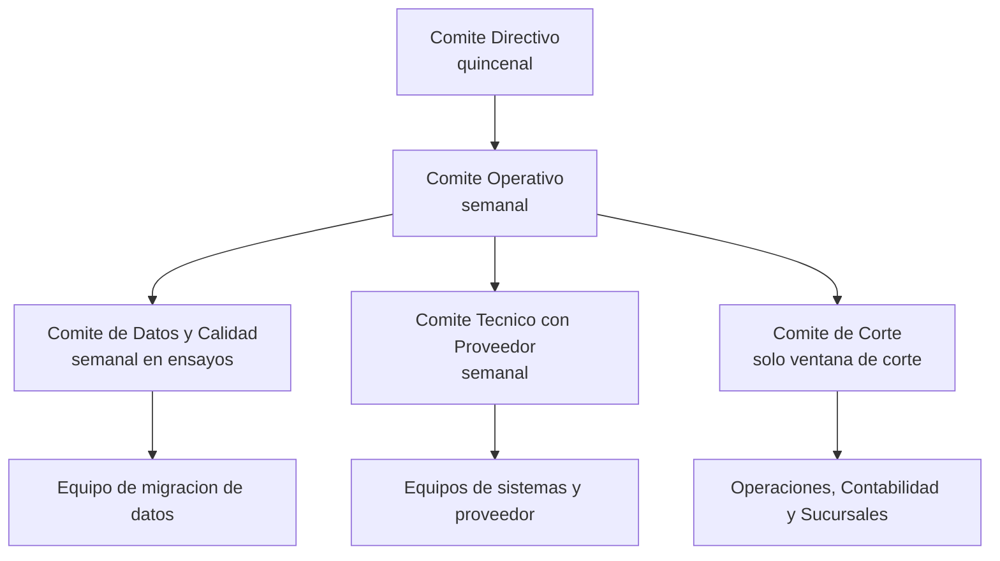

# Interesados y modelo de gobierno

| Proyecto | Migración del core bancario — Banco Meridiano Austral (entidad ficticia) |
|---|---|
| **Versión** | 1.0 |
| **Fecha** | 19/10/2026 |
| **Autor** | Franco Tilleria, Analista de Negocios |
| **Estado** | Aprobado |

## Control de versiones

| Versión | Fecha | Autor | Cambio |
|---|---|---|---|
| 1.0 | 19/10/2026 | Franco Tilleria | Versión inicial. |

## Propósito

Identificar a los interesados del proyecto, su influencia e interés, y definir el
modelo de gobierno, los comités, el escalamiento y la matriz RACI.

## Alcance

Aplica a todo el proyecto PRY-CORE-2026, desde el análisis hasta el cierre de
hypercare.

## Mapa de interesados

| Interesado | Rol | Interés | Influencia | Expectativa principal | Estrategia de gestión |
|---|---|---|---|---|---|
| Directorio | Aprobador último | Alto | Alta | Retorno y continuidad del negocio | Reporte mensual de beneficios y riesgos. |
| Gerencia General (patrocinador) | Patrocinador | Alto | Alta | Corte sin incidentes | Comité directivo quincenal; tablero go/no-go. |
| Gerencia de Sistemas | Dueña técnica | Alto | Alta | Arquitectura y operación estable | Comité operativo semanal. |
| Gerencia de Operaciones | Dueña del proceso | Alto | Alta | Cierre diario más rápido y simple | Cocreación del runbook y ensayos. |
| Gerencia de Productos | Dueña funcional | Alto | Media | Productos sin cambios para el cliente | Validación de brechas y UAT por producto. |
| Contabilidad | Control contable | Alto | Alta | Conciliación 100 % del libro mayor | Comité de datos; firmas de conciliación. |
| Riesgo y Cumplimiento | Control | Medio | Alta | Sin hallazgos; datos protegidos | Revisiones de controles y evidencias. |
| Auditoría Interna | Observador | Medio | Media | Pista de auditoría completa | Acceso al repositorio y bitácoras. |
| Sucursales y Atención al Cliente | Usuarios clave | Medio | Media | Operar sin fricción el lunes posterior | Capacitación, guías rápidas, FAQs. |
| Clientes | Beneficiarios | Bajo (directo) | Baja | Continuidad del servicio | Comunicación oportuna y transparente. |
| Proveedor del core nuevo | Proveedor | Alto | Media | Implementación exitosa y referenciable | Plan conjunto y comité técnico. |
| Proveedor del core legado | Proveedor | Bajo | Media | Continuidad contractual | Solicitud formal de soporte extendido. |
| Regulador local | Supervisor | Bajo | Alta | Cumplimiento e información oportuna | Notificación del cambio según normativa vigente. |
| Equipo de datos y QA | Ejecutores | Alto | Media | Requisitos claros y datos de prueba | Refinamiento continuo y criterios de aceptación. |

## Modelo de gobierno

**Comités y responsabilidades**

| Comité | Frecuencia | Integrantes | Decide sobre |
|---|---|---|---|
| Directivo | Quincenal | Patrocinador, gerencias, BA líder | Alcance, presupuesto, go/no-go, escalamiento nivel 3. |
| Operativo | Semanal | BA líder, Sistemas, Operaciones, QA | Plan, impedimentos, brechas, defectos. |
| Datos y Calidad | Semanal en ensayos | BA, Contabilidad, Datos | Reglas, rechazos, conciliación, ajustes. |
| Técnico con proveedor | Semanal | Arquitectura, proveedor | Interfaces, despliegues, rendimiento. |
| Corte | Solo ventana | Patrocinador, Operaciones, BA líder | Go/no-go, puntos de no retorno, reversa. |

**Escalamiento**

| Nivel | Plazo máximo | Instancia |
|---|---|---|
| N1: equipo | 24 horas | Resolución en equipo; registra en bitácora. |
| N2: comité operativo | 72 horas | Decide o eleva con análisis de impacto. |
| N3: comité directivo | 5 días hábiles | Decisión con impacto presupuestario o de alcance. |

## Matriz RACI

R = Responsable, A = Aprueba, C = Consultado, I = Informado.

| Actividad | BA líder | Patroc. | Sistemas | Operaciones | Contab. | QA | Riesgo |
|---|---|---|---|---|---|---|---|
| Análisis AS-IS y brechas | R | A | C | C | C | I | I |
| Diseño de extracción y defectos sintéticos | R | I | C | I | I | C | I |
| Mapeo y reglas de transformación | R | I | C | I | A | C | I |
| Construcción del pipeline | C | I | R | I | I | C | I |
| Ensayos de migración | R | I | C | C | C | C | I |
| Conciliación y ajustes | R | A | I | C | A | I | C |
| Estrategia y ejecución de pruebas | C | A | C | C | C | R | I |
| Corte y reversa | R | A | R | R | C | C | C |
| Gestión del cambio | R | A | I | C | I | I | I |
| Riesgos y controles | C | A | I | I | I | I | R |
| Trazabilidad | R | I | C | I | C | C | C |

## Supuestos

- Los roles corresponden a una estructura bancaria típica; los nombres de personas
  distintas al autor no se incluyen por ser una entidad ficticia.
- El comité de corte solo sesiona durante la ventana de corte y su preparación.

## Riesgos y dependencias

| Riesgo | Mitigación |
|---|---|
| Decisiones estancadas en comités | Escalamiento con plazos máximos definidos. |
| Áreas no representadas en comités | Revisión mensual del mapa de interesados. |
| Conflicto de prioridades con otros proyectos | Priorización formal del comité directivo. |

## Glosario

Ver [glosario único](../glosario.md).
