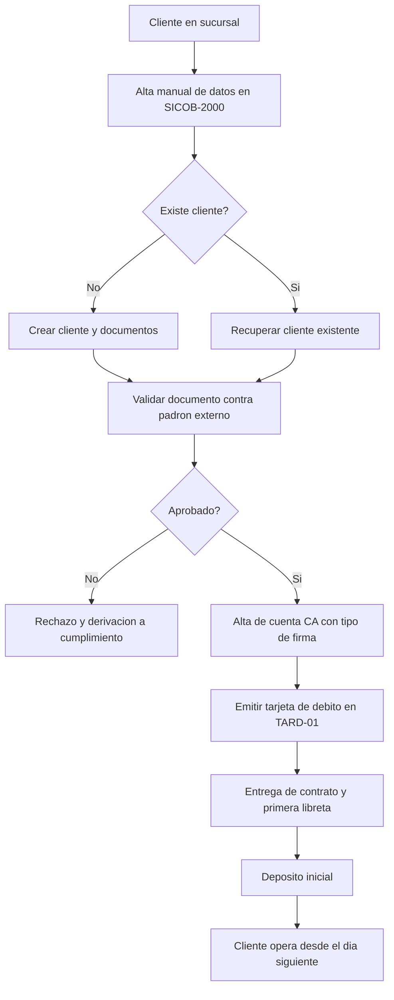
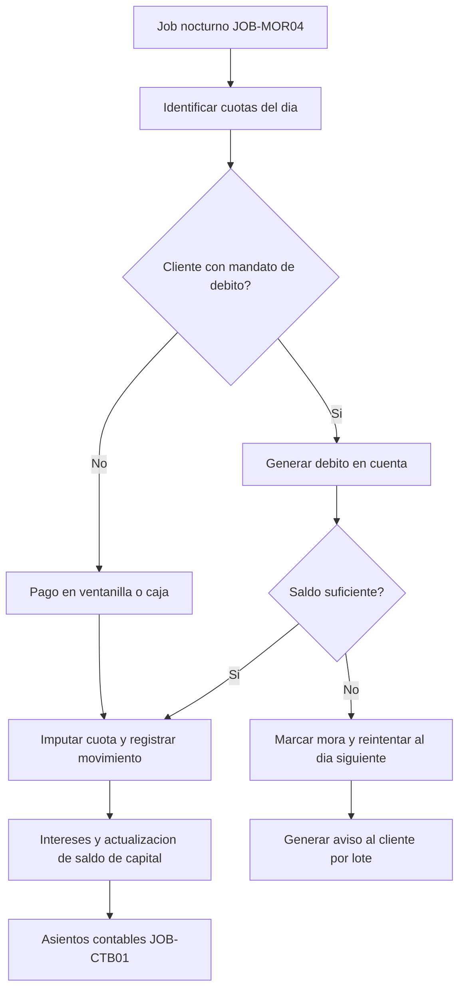
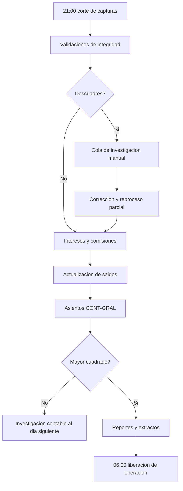

# Flujos clave AS-IS

| Proyecto | Migración del core bancario — Banco Meridiano Austral (entidad ficticia) |
|---|---|
| **Versión** | 1.0 |
| **Fecha** | 19/10/2026 |
| **Autor** | Franco Tilleria, Analista de Negocios |
| **Estado** | Aprobado |

## Control de versiones

| Versión | Fecha | Autor | Cambio |
|---|---|---|---|
| 1.0 | 19/10/2026 | Franco Tilleria | Versión inicial. |

## Propósito

Detallar tres flujos representativos del AS-IS (apertura de cuenta, cobro de cuota y
cierre diario) para identificar dependencias funcionales y puntos de dolor que la
migración debe preservar o mejorar.

## Alcance

Flujos de personas físicas en productos incluidos en el alcance.

## Flujo 1: apertura de caja de ahorro

| Paso | Sistema | Control | Dolor asociado |
|---|---|---|---|
| Alta de datos | SICOB-2000 | Duplicidad detectada por nombre exacto | PD-01 |
| Validación de documento | Padrón externo | Manual si el servicio no responde | PD-05 |
| Emisión de tarjeta | TARD-01 | Lote nocturno | PD-04 |
| Operación inicial | SICOB-2000 | Disponible al día siguiente | PD-02 |

## Flujo 2: cobro de cuota de préstamo personal

| Paso | Sistema | Regla | Dolor asociado |
|---|---|---|---|
| Identificación de cuotas | SICOB-2000 | Vencimiento = día del mes pactado | PD-03 |
| Débito automático | SICOB-2000 + SWT-Red | Reintento único nocturno | PD-03 |
| Imputación | SICOB-2000 | Orden: interés causado, capital | — |
| Notificación | CIERRE-RPT | Lote diario; el cliente avisa tarde | PD-06 |

## Flujo 3: cierre diario

| Paso | Control | Evidencia | Dolor asociado |
|---|---|---|---|
| Validaciones de integridad | Conteos por archivo | Reporte de cierre | PD-07 |
| Investigación de descuadres | Manual, hoja de cálculo | Correo de Operaciones | PD-07 |
| Cuadre del mayor | Manual contra CONT-GRAL | Planilla mensual | PD-08 |

## Resumen de puntos de dolor referenciados

Los identificadores PD-xx se detallan en [puntos de dolor](puntos-de-dolor.md) con su
impacto y la forma de verificarlos con evidencia.

## Supuestos

- Los flujos son una simplificación funcional; no incluyen excepciones de mostrador.
- Los identificadores de jobs coinciden con el documento del batch nocturno.

## Riesgos y dependencias

| Riesgo | Mitigación |
|---|---|
| Flujos con variantes locales por sucursal | Refinamiento con jefes de sucursal en UAT. |
| Reglas de imputación de cuotas incompletas | Validación con Producto y Contabilidad. |

## Glosario

Ver [glosario único](../glosario.md).
