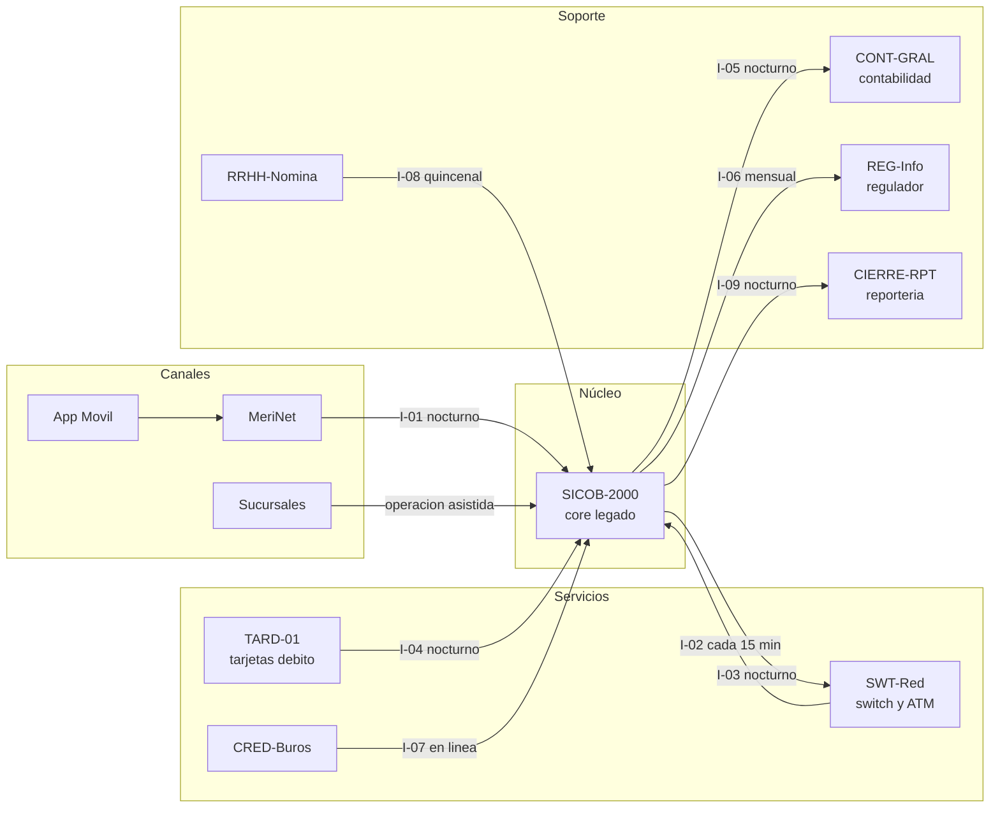

# Inventario de sistemas e interfaces (AS-IS)

| Proyecto | Migración del core bancario — Banco Meridiano Austral (entidad ficticia) |
|---|---|
| **Versión** | 1.0 |
| **Fecha** | 19/10/2026 |
| **Autor** | Franco Tilleria, Analista de Negocios |
| **Estado** | Aprobado |

## Control de versiones

| Versión | Fecha | Autor | Cambio |
|---|---|---|---|
| 1.0 | 19/10/2026 | Franco Tilleria | Versión inicial. |

## Propósito

Inventariar los sistemas, interfaces y flujos de información del estado actual
(AS-IS) para dimensionar el impacto de la migración del core.

## Alcance

Sistemas que intercambian información con el core legado y canales que dependen de
él. No incluye sistemas de infraestructura interna ni herramientas de escritorio.

## Sistemas identificados

| ID | Sistema | Función | Tecnología | Criticidad |
|---|---|---|---|---|
| S-01 | SICOB-2000 | Core legado: clientes, cuentas, saldos, movimientos, préstamos, plazos fijos y contabilidad | COBOL batch, archivos VSAM, ancho fijo | Crítica |
| S-02 | MeriNet | Home banking de personas | Aplicación web con archivos de intercambio nocturnos | Alta |
| S-03 | App Meridiano Móvil | Banca móvil de personas | Consume servicios de MeriNet | Alta |
| S-04 | SWT-Red | Switch de pagos y red de cajeros (ATM) | Procesamiento transaccional con autorización en línea | Crítica |
| S-05 | TARD-01 | Motor satélite de tarjetas de débito | Propietario; emisión y autorización local | Alta |
| S-06 | CRED-Burós | Consulta a burós de crédito | Web services SOAP | Media |
| S-07 | CONT-GRAL | Contabilidad general corporativa | ERP contable; recibe asientos por archivo | Crítica |
| S-08 | REG-Info | Presentación de información al regulador | Generación de archivos normados desde el core | Alta |
| S-09 | CIERRE-RPT | Reportería de cierre y extractos | Jobs batch sobre la base del core | Media |
| S-10 | RRHH-Nomina | Acreditación de haberes | Recibe archivo de pago del core | Media |

## Interfaces del core legado

| ID | Origen | Destino | Mecanismo | Frecuencia | Formato | Criticidad |
|---|---|---|---|---|---|---|
| I-01 | S-01 | S-02 / S-03 | Archivo plano de posiciones y movimientos | Nocturna (1 vez/día) | Ancho fijo, 6 cortes | Alta |
| I-02 | S-04 | S-01 | Archivo de transacciones autorizadas | Cada 15 minutos | Ancho fijo con secuencia | Crítica |
| I-03 | S-01 | S-04 | Archivo de saldos y estados de cuenta | Nocturna | Ancho fijo | Crítica |
| I-04 | S-05 | S-01 | Movimientos de tarjeta de débito | Nocturna | Archivo propietario | Alta |
| I-05 | S-01 | S-07 | Asientos contables del día | Nocturna post-cierre | Archivo de asientos | Crítica |
| I-06 | S-01 | S-08 | Archivos normados | Mensual y a demanda | Formatos normados | Alta |
| I-07 | S-06 | S-01 | Resultado de consulta de buró | En línea (síncrona) | SOAP | Media |
| I-08 | S-10 | S-01 | Órdenes de pago de haberes | Quincenal | Ancho fijo | Media |
| I-09 | S-09 | S-01 | Extracciones para reportería | Nocturna | Acceso directo a base | Media |

## Mapa de flujo de información

## Características del core legado

- Procesamiento exclusivamente por lotes nocturnos; durante el día solo se acumulan
  capturas que se aplican de noche.
- Archivos de ancho fijo con diseños de registro tipo copybook; sin APIs.
- Importes con decimales implícitos y signo final; fechas AAMMDD con ambigüedad de
  siglo (ver [diseño de la extracción](../04-datos-de-origen/diseno-de-la-extraccion.md)).
- Ventana operativa de cierre: 21:00 a 06:00; sin operación los fines de semana para
  cierres masivos.
- Cambios evolutivos: 4 a 6 meses de plazo y costo elevado por dependencia del
  proveedor único.

## Supuestos

- El inventario es representativo de una banca minorista típica; los nombres de
  sistemas son ficticios.
- Los mecanismos y frecuencias de interfaz son ilustrativos y consistentes con el
  resto del repositorio.

## Riesgos y dependencias

| Riesgo | Mitigación |
|---|---|
| Interfaces no documentadas del legado | Contraste con operaciones y monitoreo de archivos. |
| Dependencia del switch en línea | Ventana de corte acordada con la red de pagos. |
| Contabilidad con formatos propietarios | Mapeo temprano con Contabilidad (fase 5). |

## Glosario

Ver [glosario único](../glosario.md).
