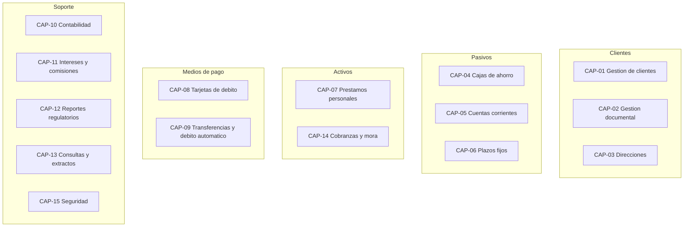

# Mapa de capacidades de negocio (AS-IS)

| Proyecto | Migración del core bancario — Banco Meridiano Austral (entidad ficticia) |
|---|---|
| **Versión** | 1.0 |
| **Fecha** | 19/10/2026 |
| **Autor** | Franco Tilleria, Analista de Negocios |
| **Estado** | Aprobado |

## Control de versiones

| Versión | Fecha | Autor | Cambio |
|---|---|---|---|
| 1.0 | 19/10/2026 | Franco Tilleria | Versión inicial. |

## Propósito

Describir las capacidades de negocio que soporta el core legado, su madurez actual
y su criticidad, como línea base para el análisis de brechas (fase 3).

## Alcance

Capacidades soportadas por el core y sus interfaces directas. No incluye capacidades
de rubros fuera de alcance (tarjetas de crédito, comercio exterior, inversiones),
que se documentan como satélites.

## Capacidades

| ID | Capacidad | Descripción | Sistema actual | Criticidad | Madurez (1–5) |
|---|---|---|---|---|---|
| CAP-01 | Gestión de clientes | Alta, modificación, inactivación y datos básicos de personas | SICOB-2000 | Alta | 2 |
| CAP-02 | Gestión documental | Registro y vigencia de documentos de identidad | SICOB-2000 | Alta | 2 |
| CAP-03 | Gestión de direcciones | Domicilios particulares y laborales | SICOB-2000 | Media | 2 |
| CAP-04 | Administración de cajas de ahorro | Apertura, depósitos, extracciones, cierre | SICOB-2000 | Crítica | 2 |
| CAP-05 | Administración de cuentas corrientes | Apertura, cheques, descubierto, cierre | SICOB-2000 | Crítica | 2 |
| CAP-06 | Depósitos a plazo fijo | Constitución, renovación, cancelación anticipada | SICOB-2000 | Alta | 3 |
| CAP-07 | Préstamos personales | Originación, desembolso, cobro de cuotas, cancelación | SICOB-2000 | Crítica | 3 |
| CAP-08 | Tarjetas de débito | Emisión, reposición, bloqueo, asociación a cuenta | TARD-01 + SICOB-2000 | Alta | 3 |
| CAP-09 | Medios de pago | Transferencias, débito automático, pago de servicios | SWT-Red | Crítica | 2 |
| CAP-10 | Contabilidad de productos | Asientos, mayor y cierre contable | SICOB-2000 + CONT-GRAL | Crítica | 2 |
| CAP-11 | Intereses y comisiones | Cálculo nocturno de intereses, comisiones e impuestos | SICOB-2000 | Crítica | 2 |
| CAP-12 | Reportes regulatorios | Generación de información normada | REG-Info | Alta | 2 |
| CAP-13 | Consultas de saldo y extractos | Posición del cliente y extractos periódicos | MeriNet / SICOB-2000 | Alta | 2 |
| CAP-14 | Cobranzas y mora | Seguimiento de cuotas vencidas y refinanciaciones | SICOB-2000 | Media | 2 |
| CAP-15 | Seguridad y accesos | Perfiles de usuario y auditoría de operaciones | SICOB-2000 | Alta | 1 |

## Mapa visual (capacidades por dominio)

## Observaciones sobre madurez

- La madurez se puntúa de 1 (manual o insuficiente) a 5 (automatizado y medido).
- Las capacidades críticas con madurez 2 (intereses, contabilidad, reportes) son las
  que generan la mayor parte de los controles manuales y reprocesos nocturnos.
- La capacidad CAP-15 (seguridad) presenta madurez 1: sin segregación formal de
  funciones ni pista de auditoría continua; se migra con desarrollo en el core nuevo.

## Supuestos

- La puntuación de madurez es una estimación funcional ilustrativa del equipo de
  análisis, validada con Operaciones.

## Riesgos y dependencias

| Riesgo | Mitigación |
|---|---|
| Capacidades sin dueño funcional claro | Designación de dueño por capacidad en comité operativo. |
| Madurez subestimada/sobreestimada | Calibración con incidentes históricos de Operaciones. |

## Glosario

Ver [glosario único](../glosario.md).
