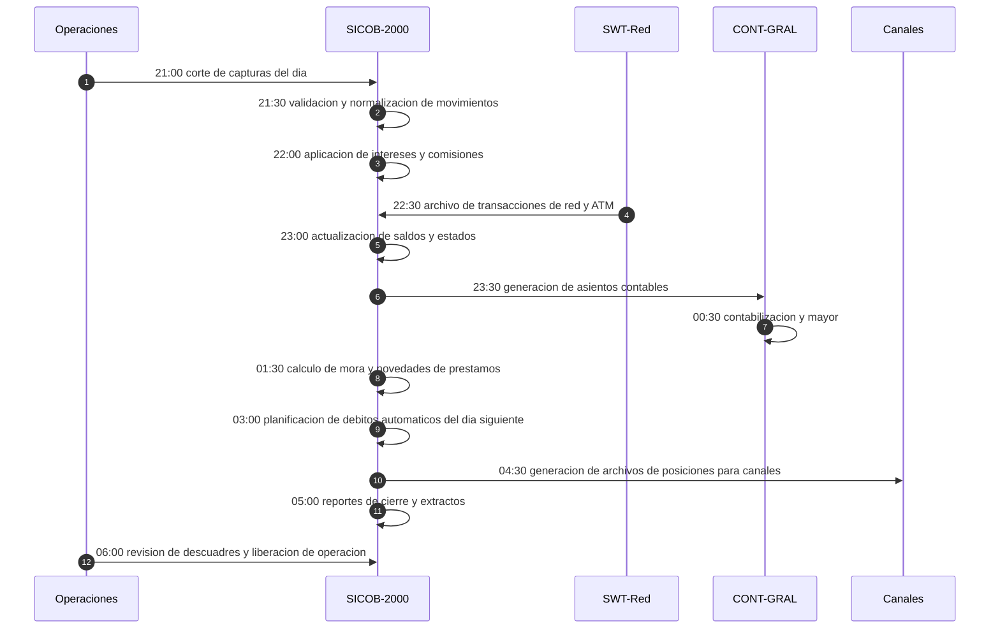

# Proceso batch nocturno (AS-IS)

| Proyecto | Migración del core bancario — Banco Meridiano Austral (entidad ficticia) |
|---|---|
| **Versión** | 1.0 |
| **Fecha** | 19/10/2026 |
| **Autor** | Franco Tilleria, Analista de Negocios |
| **Estado** | Aprobado |

## Control de versiones

| Versión | Fecha | Autor | Cambio |
|---|---|---|---|
| 1.0 | 19/10/2026 | Franco Tilleria | Versión inicial. |

## Propósito

Describir el proceso batch nocturno del core legado: etapas, secuencia, tiempos,
dependencias y consecuencias operativas. Es el proceso más afectado por la migración.

## Alcance

Proceso de cierre diario del core legado, de lunes a viernes, y sus cierres
especiales de fin de mes.

## Secuencia del cierre diario

## Etapas y tiempos

| # | Etapa | Inicio | Fin | Duración | Depende de |
|---|---|---|---|---|---|
| 1 | Corte de capturas del día | 21:00 | 21:30 | 30 min | Cierre de sucursales |
| 2 | Validación y normalización | 21:30 | 22:00 | 30 min | Etapa 1 |
| 3 | Intereses, comisiones e impuestos | 22:00 | 22:30 | 30 min | Etapa 2 |
| 4 | Incorporación de red ATM y POS | 22:30 | 23:00 | 30 min | Archivo del switch |
| 5 | Actualización de saldos y estados | 23:00 | 23:30 | 30 min | Etapas 3 y 4 |
| 6 | Asientos y contabilidad | 23:30 | 01:30 | 120 min | Etapa 5 |
| 7 | Mora y novedades de préstamos | 01:30 | 02:30 | 60 min | Etapa 5 |
| 8 | Planificación de débitos automáticos | 02:30 | 03:00 | 30 min | Etapa 5 |
| 9 | Archivos de posiciones para canales | 03:00 | 04:30 | 90 min | Etapa 5 |
| 10 | Reportes de cierre y extractos | 04:30 | 05:30 | 60 min | Etapas 6 y 9 |
| 11 | Revisión de descuadres y liberación | 05:30 | 06:00 | 30 min | Etapa 10 |

Duración total típica: **9 horas** (21:00 a 06:00). Los cierres de fin de mes suman
hasta 3 horas adicionales por procesos de intereses y reportes regulatorios.

## Jobs principales

| Job | Descripción | Orden | Reproceso seguro |
|---|---|---|---|
| JOB-CIE01 | Corte de capturas | 10 | Sí (re-extrae capturas) |
| JOB-INT03 | Intereses y comisiones | 30 | Sí, con marca de idempotencia |
| JOB-RED02 | Incorporación de red ATM/POS | 40 | No; requiere control manual de secuencia |
| JOB-SAL05 | Actualización de saldos | 50 | Sí |
| JOB-CTB01 | Asientos contables | 60 | Sí, reemplaza asientos del día |
| JOB-MOR04 | Mora y novedades | 70 | Sí |
| JOB-DEB06 | Débitos automáticos | 80 | No duplica por control de mandatos |
| JOB-CAN09 | Posiciones para canales | 90 | Sí |

## Consecuencias operativas

- Los clientes ven sus movimientos del día **recién a la mañana siguiente**.
- Cualquier falla en la cadena retrasa la apertura; históricamente, el 4 % de los
  días hábiles presentó al menos un reproceso (dato ilustrativo de Operaciones).
- Los descuadres contables se investigan manualmente al día siguiente.
- Cambios de parámetros (tasas, comisiones) requieren ventanas especiales de fin de
  semana y pruebas con archivos completos.

## Supuestos

- Horarios y duraciones son ilustrativos de una banca minorista con este diseño batch.
- Los jobs no compiten con otros sistemas durante la ventana nocturna.

## Riesgos y dependencias

| Riesgo | Mitigación en AS-IS | Situación tras migración |
|---|---|---|
| Fallas de job de red (JOB-RED02) | Reproceso manual con control de secuencia | Operación casi en línea; sin reproceso por archivo |
| Descuadres contables detectados tarde | Investigación manual al día siguiente | Conteos y sumas de control automáticos |
| Ventana insuficiente en cierre de mes | Adelanto del inicio a las 19:00 | Cierre objetivo ≤ 2 horas |

## Glosario

Ver [glosario único](../glosario.md).
