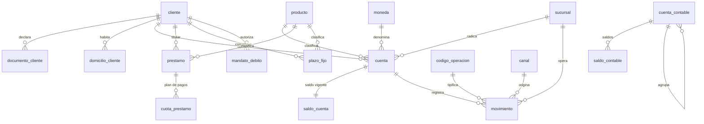

# Modelo de datos del destino

| Proyecto | Migración del core bancario — Banco Meridiano Austral (entidad ficticia) |
|---|---|
| **Versión** | 1.0 |
| **Fecha** | 19/10/2026 |
| **Autor** | Franco Tilleria, Analista de Negocios |
| **Estado** | Aprobado |

## Control de versiones

| Versión | Fecha | Autor | Cambio |
|---|---|---|---|
| 1.0 | 19/10/2026 | Franco Tilleria | Versión inicial. |

## Propósito

Definir el modelo de datos del core destino (MERIDIANO-CORE) al que se migra, y sus
reglas de diseño: claves, integridad referencial, catálogos y columnas derivadas.
Este modelo es la fuente única que consumen el mapeo campo a campo
([mapeo de datos](mapeo-de-datos.md)), las reglas
([reglas de transformación](reglas-de-transformacion.md)) y las validaciones del
pipeline.

## Principios de diseño

1. **Identificadores preservados:** las claves del legado (id_cliente, id_cuenta,
   id_movimiento, id_prestamo, id_plazo, id_mandato) se conservan como claves
   primarias. La trazabilidad fila a fila es una unión por clave, sin tablas de
   correspondencia adicionales.
2. **Catálogos derivados de la extracción:** no se inventan códigos. Los catálogos
   (producto, sucursal, moneda, tipo de documento, operación, canal, servicio) se
   construyen con los valores distintos que aparecen en la extracción y su mapeo a
   valores de negocio.
3. **Columnas derivadas explícitas:** toda columna que no existe en el origen está
   marcada como derivada y asociada a una regla con nombre (RN-xx). Nada se calcula
   "en el camino".
4. **Sin datos sensibles en claro:** los números de tarjeta se persisten
   enmascarados desde el primer momento; ningún informe muestra el número completo.
5. **Estados con dominio cerrado:** cada estado del destino pertenece a un dominio
   documentado; los valores desconocidos van a revisión, no se normalizan a la
   fuerza.

## Diagrama del modelo

## Tablas del modelo

<!-- INICIO AUTO: resumen-modelo -->
| Tabla | Descripción | Clave primaria | Origen | Columnas |
|---|---|---|---|---:|
| `cliente` | Personas físicas titulares de cuentas, créditos y servicios. | `id_cliente` | `clientes.dat` | 10 |
| `documento_cliente` | Documentos de identidad declarados, con vigencia y validación. | `id_documento` | `documentos.dat` | 10 |
| `domicilio_cliente` | Domicilios particulares y laborales declarados. | `id_domicilio` | `direcciones.dat` | 11 |
| `cuenta` | Cuentas de depósito vigentes e históricas. | `id_cuenta` | `cuentas.dat` | 13 |
| `saldo_cuenta` | Saldo de apertura de la ventana y saldo final por cuenta. | `id_cuenta` | `saldos.dat` | 5 |
| `movimiento` | Movimientos de la ventana de 12 meses y de la carga delta del corte. | `id_movimiento` | `movimientos.dat` | 11 |
| `prestamo` | Préstamos personales con su estado y saldo de capital. | `id_prestamo` | `prestamos.dat` | 14 |
| `cuota_prestamo` | Plan de pagos de cada préstamo (una fila por cuota). | `id_prestamo, numero_cuota` | `cuotas.dat` | 8 |
| `plazo_fijo` | Depósitos a plazo fijo con condiciones y estado. | `id_plazo` | `plazos_fijos.dat` | 11 |
| `mandato_debito` | Mandatos de débito automático de servicios y cuotas. | `id_mandato` | `mandatos.dat` | 9 |
| `cuenta_contable` | Plan de cuentas contable del core nuevo. | `codigo_contable` | `plan_cuentas.dat` | 6 |
| `saldo_contable` | Saldos del libro mayor por cuenta contable y período. | `codigo_contable, periodo` | `saldos_contables.dat` | 5 |
| **Total: 12 tablas** |  |  |  | **113** |

El modelo tiene 12 tablas y 113 columnas; 7 columnas son derivadas (no existen en la extracción y las calcula una regla del pipeline).
<!-- FIN AUTO: resumen-modelo -->

## Catálogos

<!-- INICIO AUTO: catalogos-modelo -->
| Catálogo | Columnas | Códigos | Códigos especiales |
|---|---|---:|---|
| `producto` | codigo, nombre, familia, moneda | 10 | `TR` (rechazar), `XX` (revisión), `PH` (rechazar) |
| `sucursal` | codigo, nombre | — | Derivado de la extracción: códigos 0001 a 0350, todos activos. |
| `moneda` | codigo, nombre | 2 | — |
| `tipo_documento` | codigo, nombre | 3 | — |
| `codigo_operacion` | codigo, nombre, signo | 9 | — |
| `canal` | codigo, nombre | 4 | — |
| `servicio_mandato` | codigo, nombre | 4 | — |
<!-- FIN AUTO: catalogos-modelo -->

## Reglas de integridad

| Tipo | Tratamiento en la migración |
|---|---|
| Referencias a cliente inexistente (cuentas huérfanas) | No se cargan: van a cola de revisión con motivo `cuenta_huerfana`. |
| Referencias a cuenta inexistente (movimientos) | Rechazo bloqueante: sin cuenta no hay imputación posible. |
| Documento duplicado entre clientes | Cola de revisión (`documento_repetido`) con evidencia para resolución manual. |
| Estados fuera de dominio | Se cargan como `desconocida`/revisión, nunca se adivinan. |
| Descuadres contables | Se reportan y ajustan solo con evidencia y aprobación ([ADR-012](../decisiones/ADR-012-ajustes-de-migracion.md)). |

Las columnas derivadas y su regla asociada se detallan en el
[mapeo de datos](mapeo-de-datos.md); los parámetros de cada ensayo, en
[reglas de transformación](reglas-de-transformacion.md).
